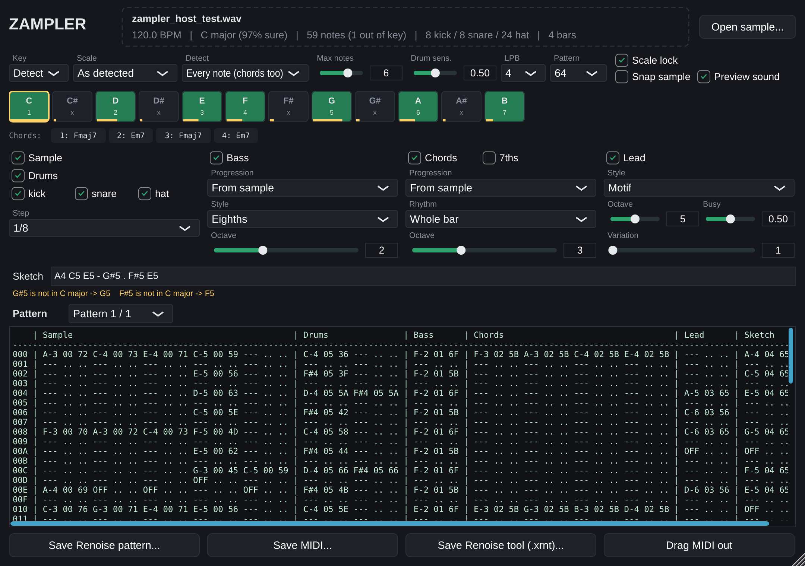

# Zampler plugin (VST3 / CLAP / AU / Standalone)



This is the same idea as the Streamlit app, built as a plugin that runs inside Renoise or
any other DAW. Drop a sample on it, and it maps the sample to tracker notes. You then build
drums, bass, chords and leads that are locked to the sample's key, play them back in sync
with the host, and export them to Renoise or as MIDI.

## What's inside

| | |
|---|---|
| `engine/` | Standard C++17 only, no JUCE: a port of the Python engine, unit-tested on its own |
| `engine/Analysis.cpp` | YIN melody tracking (difference function via FFT), tempo (onset autocorrelation, then snapped to the note grid), key (Krumhansl), chords per bar |
| `engine/Poly.cpp` | Every note inside chords: a 1/3-semitone constant-Q transform (low octaves computed on decimated copies of the signal), harmonic salience, spectral-smoothness overtone removal, peak gating, held-note stitching |
| `engine/Drums.cpp` | Kick / snare / hat: HPSS (median filtering), per-band energy jumps, no fake drums on melodic samples; pitched drum tones are kept out of the notes |
| `engine/Tracker.cpp` | Grid, note columns, OFFs, Renoise-style pattern text, the bass/chord/lead/sketch/drum generators, the MIDI file writer and the Renoise pattern exporter |
| `source/` | The JUCE plugin: drop zone, note map, builders, pattern view, exports, drag MIDI out, host-synced playback with a small preview synth |
| `tests/EngineTests.cpp` | The same synthetic test signals as the Python tests |
| `tests/HostTest.cpp` | Loads the built VST3 like a DAW does, plays it with a fake host transport, checks the MIDI it sends, and renders the editor to a PNG |

## Build

Requirements: CMake 3.22+ and a C++17 compiler. JUCE 8.0.10 and clap-juce-extensions are
downloaded automatically, or you can point CMake at local copies with
`-DZAMPLER_JUCE_DIR=…` / `-DZAMPLER_CLAP_JUCE_DIR=…`.

```bash
cd plugin
cmake -B build -DCMAKE_BUILD_TYPE=Release
cmake --build build --config Release -j
ctest --test-dir build -C Release                     # engine tests
```

The results are in `build/Zampler_artefacts/Release/`: `VST3/Zampler.vst3`,
`CLAP/Zampler.clap`, `Standalone/Zampler`, and `AU/Zampler.component` on macOS. Copy them to
your plugin folder:

| OS | VST3 | CLAP |
|---|---|---|
| Windows | `C:\Program Files\Common Files\VST3` | `C:\Program Files\Common Files\CLAP` |
| macOS | `~/Library/Audio/Plug-Ins/VST3` | `~/Library/Audio/Plug-Ins/CLAP` |
| Linux | `~/.vst3` | `~/.clap` |

On Linux you need the usual JUCE packages: `libasound2-dev libx11-dev libxrandr-dev
libxcursor-dev libxinerama-dev libxext-dev libfreetype-dev libfontconfig1-dev
libgl1-mesa-dev`.

Engine only (no JUCE, builds in seconds):

```bash
cmake -B build-engine -DZAMPLER_BUILD_PLUGIN=OFF && cmake --build build-engine && ctest --test-dir build-engine
```

Host test (Linux needs a display, so `xvfb-run` works for headless):

```bash
cmake --build build --target zampler_host_test
xvfb-run -a build/zampler_host_test_artefacts/Release/zampler_host_test \
    build/Zampler_artefacts/Release/VST3/Zampler.vst3 editor.png
```

## Using it in Renoise

1. Load **Zampler** as an instrument plugin (it's a VST3/CLAP instrument).
2. Open its editor and drag a sample onto the dashed drop zone, or click *Open sample…*.
3. Set it up:
   - **Key:** detected automatically, or set it by hand.
   - **Scale lock:** on by default. Every generated or typed note is forced into the key.
   - **Detect:** *Every note* shows chords and harmonies across note columns; *Melody line* shows just the top line.
   - **Builders:** Drums (kick/snare/hat toggles), Bass (*Follow the kick* follows the sample's kick pattern), Chords, Lead.
   - **Sketch:** type notes such as `A3 C4 E4 - G4 . F4`. A wrong note is moved into the key and a message tells you what changed.
4. Press play in Renoise. Zampler plays the parts in time with the song: through its
   built-in preview sounds (turn *Preview sound* off to mute them) and as MIDI on
   channel 1 = sample, 10 = drums, then bass, chords, lead and sketch.
5. Get the notes into your patterns:
   - *Save Renoise tool (.xrnt)…*: drag the saved file onto Renoise once to install it.
   - *Save Renoise pattern…*: then in Renoise choose **Tools → Zampler → Import Pattern File…**.
     Each part becomes its own track, starting at the selected pattern.
     Instruments: `00` sample, `01` bass, `02` chords, `03` lead, `04` sketch, `05` drums
     (kick C-4, snare D-4, hat F#4).
   - Or use **Drag MIDI out** / *Save MIDI…* for any DAW.

All settings and the sample path are saved with your song, and the sample is analysed
again when the song is reopened.

## Limits

- The analysis looks at the first 90 seconds of the sample.
- *Every note* works best on clean, tonal loops. Very dense mixes may lose or add a few notes.
- AU is only built on macOS. CLAP has been built but not yet tested in a CLAP host.
